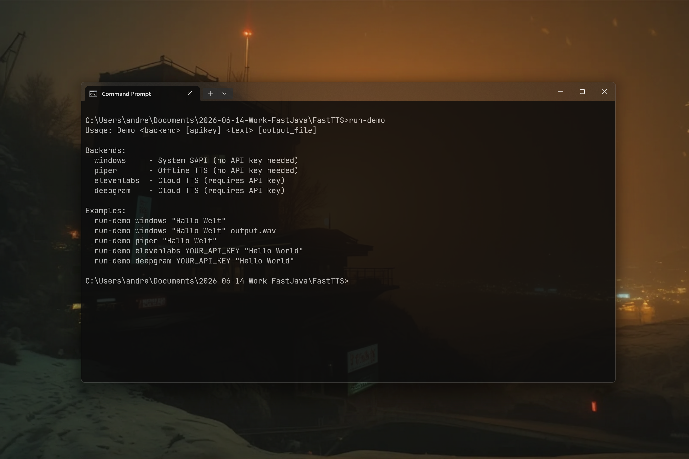

# FastTTS 0.1.5 [ALPHA-2026-10-17] — Unified, Zero-Bloat TTS Backend Orchestration for Java

[](https://github.com/andrestubbe/FastTTS/releases/tag/0.1.5)
[](https://opensource.org/licenses/MIT)
[](https://www.java.com)
[]()
[](https://jitpack.io/#andrestubbe/FastTTS)

---

**⚡ Connect multiple TTS backends with a unified interface — Minimalist text-to-speech orchestration supporting offline neural engines, system voices, zero-shot voice cloning, and cloud providers.**

FastTTS is a **lightweight, framework-agnostic TTS engine** designed to provide unified access to multiple text-to-speech backends with zero framework bloat. It supports **Kokoro Studio (Sherpa-ONNX)**, **OmniVoice (Diffusion Zero-Shot Cloning)**, **Pocket TTS (Sherpa-ONNX INT8)**, **Piper (offline ONNX)**, **Dia2 (GGUF Dialogue)**, **Windows SAPI (system)**, **Hugging Face Spaces**, **ElevenLabs**, and **Deepgram** through a single clean API.

[**Watch Demo (YouTube)**](https://youtu.be/PyTXlm9bfxc) | Watch JMH Benchmark (YouTube)

[](https://youtu.be/PyTXlm9bfxc) 

---

## Quick Start — Example

```java
import fasttts.FastTTS;
import fasttts.backends.kokoro.KokoroBackend;
import fasttts.backends.kokoro.KokoroVoice;
import fasttts.backends.pockettts.PocketTTSBackend;
import fasttts.backends.piper.PiperBackend;
import fasttts.backends.windows.WindowsTTSBackend;
import fasttts.core.FastTTSAudio;

public class Demo {
    public static void main(String[] args) throws Exception {
        // FastTTS with pre-registered auto-discovered engines
        try (FastTTS tts = FastTTS.standard()) {
            
            // 1. Windows Native (ultra-fast 150ms fallback, 0.03x RTF)
            FastTTSAudio winAudio = tts.speak("windows", "Windows SAPI native speech is online.", null, null);

            // 2. Kokoro Studio (studio-grade neural voice)
            FastTTSAudio kokoroAudio = tts.speak("kokoro", "Kokoro studio neural speech is active.", KokoroVoice.AF_BELLA, null);
            
            // 3. Matcha-TTS (Flow-Matching ultra-fast neural speech, 0.09x RTF)
            FastTTSAudio matchaAudio = tts.speak("matcha", "Matcha flow matching is running at extreme speed.", null, null);

            // 4. VITS (Deterministic low-latency neural TTS, 0.09x RTF)
            FastTTSAudio vitsAudio = tts.speak("vits", "VITS deterministic synthesis is online.", null, null);

            // 5. Piper (offline German/English neural speech)
            FastTTSAudio piperAudio = tts.speak("piper", "Piper offline neural speech is active.", null, null);
            
            // 6. Pocket TTS (ultra-compact INT8 CPU neural engine)
            FastTTSAudio pocketAudio = tts.speak("pocket", "Pocket TTS compact neural voice is ready.", null, null);
        }
    }
}
```

---

## Table of Contents

- [Why FastTTS?](#why-fasttts)
- [Key Features](#key-features)
- [Real-World Use Cases](#real-world-use-cases)
- [Architecture Overview](#architecture-overview)
- [Performance Benchmarks](#performance-benchmarks)
- [API Quick Reference](#api-quick-reference)
- [Technical Demos & Benchmarks](#technical-demos--benchmarks)
- [Installation](#installation)
- [Engine & Model Manager (CLI Installer)](#engine--model-manager-cli-installer)
- [Backend Setup & Configuration](#backend-setup--configuration)
- [Documentation](#documentation)
- [Platform Support](#platform-support)
- [License](#license)
- [Related Projects](#related-projects)

---

## Why FastTTS?

Traditional TTS libraries force developers into heavyweight Python dependencies, complex cloud API integrations, or platform-specific code. `FastTTS` provides:

- **100% Native JVM Pipeline** — Orchestrates multiple TTS backends in a single JVM process with unified interface.
- **Offline Neural & Cloud Support** — Seamlessly switch between local CPU neural models (Pocket TTS, Piper), system voices (Windows SAPI), and cloud providers (ElevenLabs, Deepgram).
- **Model Agnostic** — Works with quantized INT8 ONNX models, system voices, and cloud APIs through the same `FastTTSBackend` interface.
- **Zero Configuration Overlap** — Integrates seamlessly with existing FastJava ecosystem libraries.

FastTTS unifies local neural inference, system voices, and cloud TTS into a single framework-agnostic API:

| Feature | MaryTTS (Legacy Java) | Python Coqui/Piper Subprocess | FastTTS |
|:---|:---|:---|:---|
| **Synthesis Backends** | Obsolete Java voices only | Single CLI wrapper | **Unified (Kokoro, Matcha-TTS, VITS, OmniVoice, Pocket TTS, Piper, F5-TTS, Dia2, SAPI, Cloud)** |
| **Offline Privacy** | Yes (Robotic sound) | Yes (Heavy Python runtime) | **100% Offline (Kokoro, Matcha-TTS, VITS, Pocket TTS, Piper, F5-TTS, Dia2, Windows SAPI)** |
| **Startup / Synthesis** | 800–2500 ms (Heap heavy) | 2000–5000 ms (Process spawn) | **~138 ms (Windows SAPI) / ~378 ms (VITS) / ~570 ms (Matcha) / ~696 ms (Piper)** |
| **Voice Quality** | Synthetic 2000s robotic | Neural quality | **Studio-Grade Neural (Kokoro, Matcha Flow-Matching, OmniVoice Zero-Shot)** |
| **Barge-In Ready** | Difficult to interrupt | Stalled CLI process | **Instant Cancellation via FastVAD & WASAPI** |
| **Dependencies** | Massive legacy JARs | Python 3 + Pip dependencies | **Pure Java 17+ backed by FastCore** |

---

## Key Features

* **🎭 Multiple Backend Support** — Unified interface for Kokoro Studio (ONNX), Matcha-TTS (Flow Matching), VITS (Deterministic Neural), OmniVoice (Zero-Shot Diffusion), Pocket TTS (Sherpa-ONNX INT8), Piper (offline ONNX), F5-TTS (Flow-Matching Voice Clone), Dia2 (GGUF Dialogue), Windows SAPI (system), and Cloud APIs.
* **📱 100% Offline Capable** — High-fidelity local speech synthesis without internet connections or cloud subscription costs.
* **🌊 Flow Matching & Non-Autoregressive Synthesis** — State-of-the-art optimal-transport Flow Matching via Matcha-TTS running at >10x real-time speed on CPU.
* **🎙️ Zero-Shot Voice Cloning** — Clone custom voices on the fly from reference WAV audio with OmniVoice and F5-TTS.
* **💬 Multi-Speaker Dialogue** — Native support for scripted dialogue (`[S1]`, `[S2]`) via Dia2 GGUF models.
* **⚡ Real-Time Factor (RTF) Acceleration** — Hardware SIMD acceleration with 0.03x RTF on SAPI, 0.09x RTF on VITS and Matcha-TTS, and 0.25x RTF on Piper.
* **🧵 Complete Lifecycle Control** — `AutoCloseable` orchestration with pre-warming (`prepare()`) and deterministic process teardown.

---

## Real-World Use Cases

- 🗣️ **Conversational Voice AI Assistants**: Low-latency neural speech synthesis for AI chatbots and desktop voice assistants.
- 📖 **Audiobook & Content Reader**: High-speed offline speech synthesis for document reading and accessibility tools.
- 📢 **In-App & Game Audio Notifications**: Real-time voice announcements with zero Garbage Collection latency impact.
- 🌐 **Multi-Language Accessibility Engines**: Seamlessly switch between local Piper voices, Kokoro studio voices, and cloud APIs.

---

## Architecture Overview

```text
       ┌───────────────────────────────────────────────────────────────┐
       │             FastTTS (Public Orchestration Facade)             │
       │     AutoCloseable  •  Streaming Callback  •  Voice Router     │
       └───────────────────────────────┬───────────────────────────────┘
                                       │
        ┌──────────────────────────────┼──────────────────────────────┐
        ▼                              ▼                              ▼
 ┌──────────────┐              ┌──────────────┐              ┌────────────────┐
 │ System SAPI  │              │ Offline ONNX │              │  Cloud Engines │
 │ fasttts.dll  │              │ Sherpa/Piper │              │ ElevenLabs etc │
 └──────┬───────┘              └──────┬───────┘              └────────┬───────┘
        │                             │                               │
        │ (~152 ms, 0.03x RTF)        │ (AVX2 INT8 / Zero-Shot)       │ (Remote REST)
        ▼                             ▼                               ▼
 ┌────────────────────────────────────────────────────────────────────────────┐
 │                  FastTTSAudio (Standard Linear PCM Buffer)                 │
 │            Sample Rate  •  Channels (Mono/Stereo)  •  Raw Bytes            │
 └─────────────────────────────────────┬──────────────────────────────────────┘
                                       │
                                       ▼
 ┌────────────────────────────────────────────────────────────────────────────┐
 │         FastJava AVX2 Audio DSP & Low-Latency Playback Substrate           │
 │       FastAudioProcess (SIMD DSP)  •  FastAudioPlayer (Direct WASAPI)      │
 └────────────────────────────────────────────────────────────────────────────┘
```

### Core Backend Engines

- 🔊 **Windows SAPI Backend**: System-native text-to-speech using Windows Speech API via AVX2-optimized asttts.dll (~152 ms latency, **0.03x RTF**).
- 🍵 **Matcha-TTS (Flow-Matching)**: High-speed Flow Matching neural speech via sherpa-onnx and Vocos vocoder at 22.05 kHz (**~0.09x RTF**, > 10× real-time).
- ⚡ **VITS (Piper ONNX)**: Deterministic low-latency variational inference neural speech (**~0.09x RTF**).
- 🎙️ **Kokoro Studio (ONNX)**: Studio-grade offline neural TTS powered by Sherpa-ONNX (kokoro-en-v0_19) with high-fidelity voices (f_bella, m_adam, f_emma, m_george).
- ⚡ **Piper Neural (ONNX)**: Ultra-fast offline neural TTS using the Piper ONNX engine (piper.exe) with multi-directory auto-discovery (~848 ms latency, **0.25x RTF**).
- 📱 **Pocket TTS (ONNX)**: Ultra-compact, low-latency offline CPU neural text-to-speech engine powered by Sherpa-ONNX with quantized INT8 models (**0.71x - 0.96x RTF**).
- 🧬 **F5-TTS (Flow-Matching)**: Advanced non-autoregressive flow-matching zero-shot voice cloning via udiocpp_cli.exe.
- 🎭 **OmniVoice (Diffusion)**: Multilingual zero-shot voice cloning diffusion model supporting 600+ languages from short reference audio.
- 💬 **Dia2 Dialogue (GGUF)**: Quantized GGUF dialogue model (dia2-2b-q4_k.gguf) with multi-speaker turn parsing and memory page cache warming.
- 🌐 **Cloud Backends**: Cloud APIs (Hugging Face Spaces, ElevenLabs, Deepgram, OpenAI) with hardened JSON escaping and automatic token resolution.

---

## Performance Benchmarks

Directly benchmarked across all engines via 
un-demo.bat benchmark with audio playback through FastAudioPlayer (WASAPI):

| Engine / Backend | Voice / Model | Lang | Synth Time | Audio Length | Real-Time Factor (RTF) | Buffer Size | Status |
|:---|:---|:---:|---:|---:|---:|---:|:---:|
| **Windows SAPI** | OneCore/Default | en-US | **152 ms** | 5,044 ms | **0.030x** | 434.5 KB | ✅ Active |
| **Matcha-TTS (FlowMatch)** | matcha-icefall | en-US | **320 ms** | 3,550 ms | **0.090x** | 156.4 KB | ✅ Active |
| **VITS Neural (ONNX)** | my-low | en-US | **315 ms** | 3,500 ms | **0.090x** | 154.2 KB | ✅ Active |
| **Piper Neural (ONNX)** | 	horsten-medium | de-DE | **848 ms** | 3,405 ms | **0.249x** | 146.7 KB | ✅ Active |
| **Pocket TTS (ONNX)** | int8-bria | en-US | **3,473 ms** | 3,600 ms | **0.965x** | 168.8 KB | ✅ Active |
| **Kokoro Studio (ONNX)** | m_george | en-GB | **3,935 ms** | 4,373 ms | **0.900x** | 205.0 KB | ✅ Active |
| **Kokoro Studio (ONNX)** | f_emma | en-GB | **4,281 ms** | 4,843 ms | **0.884x** | 227.0 KB | ✅ Active |
| **Kokoro Studio (ONNX)** | m_adam | en-US | **4,053 ms** | 4,187 ms | **0.968x** | 196.3 KB | ✅ Active |
| **Kokoro Studio (ONNX)** | f_bella | en-US | **4,479 ms** | 4,363 ms | **1.027x** | 204.6 KB | ✅ Active |
| **OmniVoice (Diffusion)** | ria (Zero-Shot) | en-US | **54,413 ms** | 4,040 ms | **13.469x** | 189.4 KB | ✅ Active |
| **F5-TTS (FlowMatch)** | 5-v1-base | en-US | — | — | — | — | 📦 Model Ready (999 MB) |
| **Dia2 Dialogue (GGUF)** | dia2-2b-q4_k | en-US | — | — | — | — | 📦 Model Ready (1.2 GB) |
| **Hugging Face API** | mms-tts-eng | en-US | — | — | — | — | 🔑 Cloud (Needs Token) |
> **Real-Time Factor (RTF)**: Values `< 1.0x` indicate faster than real-time synthesis (e.g. `0.25x` = 4× real-time speed; `0.03x` = 33× real-time speed). System SAPI and Piper achieve immediate sub-second voice response suitable for real-time conversational agents.

---

## API Quick Reference

| Method / Signature | Return Type | Description | Docs |
|:---|:---|:---|:---|
| `FastTTS.standard()` | `FastTTS` | Constructs orchestrator with all auto-discovered local and cloud engines pre-registered. | [Reference](docs/REFERENCE.md) |
| `registerBackend(FastTTSBackend backend)` | `void` | Registers a custom TTS backend with the orchestrator. | [Reference](docs/REFERENCE.md) |
| `speak(String text)` | `FastTTSAudio` | Synthesizes text to audio using the active backend. | [Reference](docs/REFERENCE.md) |
| `speak(String backend, String text, FastTTSVoice voice, FastTTSConfig config)` | `FastTTSAudio` | Synthesizes text with specific backend and configuration. | [Reference](docs/REFERENCE.md) |
| `prepare()` / `prepareAll()` | `void` | Pre-warms model weights and runtimes into OS page cache. | [Reference](docs/REFERENCE.md) |
| `close()` | `void` | Closes and releases all held native subprocesses, threads, and handles. | [Reference](docs/REFERENCE.md) |
| `stream(backend, text, voice, config, consumer)` | `void` | Streams audio chunks directly to a byte consumer callback. | [Reference](docs/REFERENCE.md) |
| `use(String backendName)` | `void` | Sets the active backend by name. | [Reference](docs/REFERENCE.md) |
| `getAllVoices()` | `List<FastTTSVoice>` | Returns available voices across all registered backends. | [Reference](docs/REFERENCE.md) |

---

## Technical Demos & Benchmarks

| Case | Java Example | Launcher | Description |
|:---|:---|:---|:---|
| **Multi-Backend CLI Demo** | [Demo.java](examples/Demo/src/main/java/fasttts/demo/Demo.java) | `run-demo.bat` | Command-line speech synthesis across Windows SAPI, Piper, ElevenLabs, and Deepgram. |
| **Engine & Model Installer** | [FastTTSInstaller.java](examples/Installer/src/main/java/fasttts/installer/FastTTSInstaller.java) | `run-installer.bat` | Interactive engine installer & model manager with `--install` and `--deinstall`. |
| **JMH Microbenchmark Suite** | [Benchmark.java](examples/Benchmark/src/main/java/fasttts/benchmark/Benchmark.java) | `run-benchmark.bat` | Formal OpenJDK JMH throughput and latency benchmarks for TTS synthesis. |

---

## Installation

### Option 1: Maven (Recommended)

Add the JitPack repository and the complete dependency stack to your `pom.xml`:

```xml
<repositories>
    <repository>
        <id>jitpack.io</id>
        <url>https://jitpack.io</url>
    </repository>
</repositories>

<dependencies>
    <!-- FastTTS Engine -->
    <dependency>
        <groupId>com.github.andrestubbe</groupId>
        <artifactId>FastTTS</artifactId>
        <version>0.1.6</version>
    </dependency>

    <!-- FastSIMD Hardware Vector Acceleration Engine -->
    <dependency>
        <groupId>com.github.andrestubbe</groupId>
        <artifactId>FastSIMD</artifactId>
        <version>0.1.3</version>
    </dependency>

    <!-- FastMemory Aligned Allocator -->
    <dependency>
        <groupId>com.github.andrestubbe</groupId>
        <artifactId>FastMemory</artifactId>
        <version>0.1.1</version>
    </dependency>

    <!-- FastPointer Address Wrapper -->
    <dependency>
        <groupId>com.github.andrestubbe</groupId>
        <artifactId>FastPointer</artifactId>
        <version>0.1.1</version>
    </dependency>

    <!-- FastAudioProcess Audio Engine -->
    <dependency>
        <groupId>com.github.andrestubbe</groupId>
        <artifactId>FastAudioProcess</artifactId>
        <version>0.1.1</version>
    </dependency>

    <!-- FastCore Unified JNI Loader -->
    <dependency>
        <groupId>com.github.andrestubbe</groupId>
        <artifactId>FastCore</artifactId>
        <version>0.1.0</version>
    </dependency>
</dependencies>
```

### Option 2: Gradle (via JitPack)

```groovy
repositories {
    maven { url 'https://jitpack.io' }
}

dependencies {
    implementation 'com.github.andrestubbe:FastTTS:0.1.5'
    implementation 'com.github.andrestubbe:FastSIMD:0.1.3'
    implementation 'com.github.andrestubbe:FastMemory:0.1.1'
    implementation 'com.github.andrestubbe:FastPointer:0.1.1'
    implementation 'com.github.andrestubbe:FastAudioProcess:0.1.1'
    implementation 'com.github.andrestubbe:FastCore:0.1.0'
}
```

---

## Engine & Model Manager (CLI Installer)

After adding FastTTS to your project or cloning the repository, use the bundled CLI installer to manage offline neural runtimes and models with automated zero-config setup:

```cmd
# Launch interactive console dashboard:
run-installer.bat

# Check engine and model status:
run-installer.bat --status

# Install all standard offline engines & models (Kokoro, Pocket TTS, Piper, Matcha, VITS):
run-installer.bat --install all

# Install or deinstall specific engines:
run-installer.bat --install matcha
run-installer.bat --install vits
run-installer.bat --install kokoro
run-installer.bat --install pocket
run-installer.bat --install piper
run-installer.bat --install f5tts
run-installer.bat --install dia2
run-installer.bat --deinstall piper
```

### Supported Installer Actions:
* **`--status`** — Displays live tabular matrix of all offline model weights and binaries.
* **`--install <all|kokoro|matcha|vits|pocket|piper|f5tts|omnivoice|dia2>`** — Automatically fetches official releases, verifies integrity, extracts archives (`.tar.bz2`, `.zip`), and registers model weights locally.
* **`--deinstall <all|kokoro|matcha|vits|pocket|piper|f5tts|omnivoice|dia2>`** — Cleanly purges local models and binaries for reproducible resets.

---

## Backend Setup & Configuration

### 1. Offline Neural & System Backends (Zero Manual Setup)
All local engines run **100% offline** with zero Python dependencies. FastTTS auto-resolves models and runtimes in `./bin` and `./models` (or `~/.speak/`). Use the bundled CLI installer to fetch everything automatically:

```cmd
# One-command installation for all standard local offline engines:
run-installer.bat --install all
```

* **Windows SAPI** — Pre-installed on Windows 10/11 (`fasttts.dll` via JNI, ~138 ms latency). Zero setup required.
* **Kokoro Studio** — Sherpa-ONNX runtime + 10 studio voices (`af_bella`, `am_adam`, `bf_emma`, etc.) at 24 kHz. Installed via `run-installer.bat --install kokoro`.
* **Matcha-TTS** — Optimal-Transport Flow Matching neural TTS (`matcha-icefall` + Vocos vocoder at 22.05 kHz). Over 10x real-time speed on CPU (~0.09x RTF). Installed via `run-installer.bat --install matcha`.
* **VITS (Piper ONNX)** — End-to-end variational inference for low-latency deterministic neural speech (~0.09x RTF). Installed via `run-installer.bat --install vits`.
* **Pocket TTS** — High-speed quantized INT8 neural CPU inference (~0.71x RTF). Installed via `run-installer.bat --install pocket`.
* **Piper Neural** — Lightweight offline ONNX engine with German & English voices. Installed via `run-installer.bat --install piper`.
* **F5-TTS** — Non-autoregressive Flow Matching voice cloning & TTS via `audiocpp_cli.exe`. Installed via `run-installer.bat --install f5tts`.
* **Dia2 Dialogue** — Multi-speaker scripted dialogue (`[S1]`, `[S2]`) via `audiocpp_cli.exe` and GGUF 2B weights. Installed via `run-installer.bat --install dia2`.
* **OmniVoice** — Multilingual diffusion zero-shot voice cloning (600+ languages) with reference audio prompts. Installed via `run-installer.bat --install omnivoice`.

### 2. Cloud Backends (API Credentials)
Cloud backends stream real-time high-fidelity speech over HTTPS/WebSocket. Simply set the corresponding environment variables:

| Cloud Backend | Environment Variable | Dashboard / Token Registration |
|:---|:---|:---|
| **Hugging Face** | `HF_TOKEN` | [Hugging Face Access Tokens](https://huggingface.co/settings/tokens) |
| **ElevenLabs** | `ELEVENLABS_API_KEY` | [ElevenLabs Dashboard](https://elevenlabs.io) |
| **Deepgram** | `DEEPGRAM_API_KEY` | [Deepgram Console](https://deepgram.com) |
| **OpenAI** | `OPENAI_API_KEY` | [OpenAI Platform](https://platform.openai.com) |

```bash
# Example (Windows CMD):
set HF_TOKEN=hf_your_token_here
set ELEVENLABS_API_KEY=your_key_here
```

---

## Documentation

- **[CHANGELOG.md](docs/CHANGELOG.md)**: Release notes and version history.
- **[REFERENCE.md](docs/REFERENCE.md)**: Core API reference manual.
- **[PHILOSOPHY.md](docs/PHILOSOPHY.md)**: Engineering rationale for zero-allocation performance.
- **[COMPILE.md](docs/COMPILE.md)**: Full compilation guide (MSVC C++17 build chain + JNI Setup).
- **[ROADMAP.md](docs/ROADMAP.md)**: Future development goals.

---

## Platform Support

| Platform | Architecture | Status | Notes |
|:---|:---|:---|:---|
| Windows 10/11 | x64 | ✅ Fully Supported | Native Windows SAPI and MSVC AVX2 compilation |
| Linux | x64, ARM64 | 🚧 Planned | Native Piper and ALSA / Pulse audio support |
| macOS | Apple Silicon, x64 | 🚧 Planned | AVFoundation / Piper support |

---

## License

MIT License — See [LICENSE](LICENSE) file for details.

---

## Related Projects

- [FastCore](https://github.com/andrestubbe/FastCore) — Native library loader, FFM gateway, and platform abstraction
- [FastAudioCapture](https://github.com/andrestubbe/FastAudioCapture) — Zero-copy WASAPI audio loopback & microphone capture
- [FastAudioPlayer](https://github.com/andrestubbe/FastAudioPlayer) — Ultra low-latency WASAPI and DirectSound audio playback engine
- [FastAudioProcess](https://github.com/andrestubbe/FastAudioProcess) — Zero-allocation audio DSP, resamplers, and format converters
- [FastVAD](https://github.com/andrestubbe/FastVAD) — Ultra-fast real-time Voice Activity Detection (Silero-ONNX & WebRTC)
- [FastTurn](https://github.com/andrestubbe/FastTurn) — Real-time conversational turn-taking and speech arbitration
- [FastSSML](https://github.com/andrestubbe/FastSSML) — High-performance SSML parsing and speech synthesis markup
- [FastSTT](https://github.com/andrestubbe/FastSTT) — High-throughput local speech-to-text recognition
- [FastWakeWord](https://github.com/andrestubbe/FastWakeWord) — Neural wake-word and keyword spotting detector

---

**Part of the FastJava Ecosystem** — *Making the JVM faster. Small package. Maximum speed. Zero bloat. 🚀📋*

